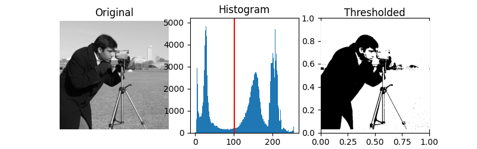

# Obiectiv

Citirea și afișarea imaginilor în tonuri de gri în Matlab, interpretarea
histogramelor acestora și implementarea binarizării imaginilor prin căutarea
pragului cu metoda Otsu, pe baza varianțelor din interiorul grupurilor.

# Aspecte teoretice

## O imagine în tonuri de gri este o matrice

O imagine digitală este o matrice dreptunghiulară de **pixeli**.

O imagine în tonuri de gri (*grayscale*) are câte o valoare pentru fiecare pixel, valorile fiind aranjate într-o matrice `I`.

Valorile pixelilor sunt numere între 0 și 1 (de tip `double`) sau între 0 și 255 (de tip `uint8`).

- 0 reprezintă negru;
- valoarea maximă (1 sau 255) reprezintă alb;
- valorile intermediare reprezintă nuanțe de gri.

În acest laborator, preferăm valori ale pixelilor în intervalul 0--1, de tip `double`,
care permite calcule precise.

De exemplu, următoarele comenzi creează și afișează o imagine mică în tonuri de gri:

```matlab
I_small = [0 0.25 0.5 1; 0 0.25 0.5 1; 0 0.25 0.5 1]; % O matrice de 3 pe 4 cu valori între 0 și 1
imshow(I_small)
```

Imaginile pot fi citite dintr-un fișier cu funcția `imread()`, ca în exemplul de mai jos:

```matlab
I = imread('coins.png');
% I = rgb2gray(I);  % Dacă imaginea este RGB, se convertește la grayscale
I = im2double(I);
imshow(I)
```

Funcții folosite:

- `imread()` citește o imagine dintr-un fișier și returnează matricea pixelilor;
- `rgb2gray()` convertește o imagine RGB în grayscale, dacă este necesar;
- `im2double()` convertește matricea imaginii la tipul `double` și îi rescalează valorile în intervalul 0--1.
- `imshow()` afișează matricea ca imagine.

Imaginile folosite în acest laborator sunt deja în tonuri de gri, deci
nu trebuie convertite din RGB în *grayscale*.


## Histograma imaginii

Histograma imaginii numără câți pixeli au fiecare valoare, și arată
distribuția valoriloe.

Folosiți `imhist()` pentru a afișa histograma imaginii:

```matlab
figure
imhist(I)
xlabel('Intensitate')
ylabel('Număr de pixeli')
```

Pentru o imagine în tonuri de gri, `imhist(I)` folosește implicit 256 de intervale.
Folosiți `imhist(I,64)` pentru a specifica un alt număr de intervale (aici 64).

Pentru a transforma o matrice într-un vector, concatenând toate coloanele, folosiți `I(:)`.
Acest lucru este util pentru calculele care nu depind de pozițiile pixelilor:

```matlab
pixels = I(:);
```


{width=95% fig-align="center"}


## Compararea cu un prag și binarizarea imaginilor

**Binarizarea unei imagini** transformă o imagine în tonuri de gri într-o imagine binară,
cu doar două valori (0=negru și 1=alb).

Putem face acest lucru prin **compararea cu un prag**, adică prin compararea cu o valoare de prag $T$:

- toți pixelii $\leq T$ devin 0
- toți pixelii $> T$ devin 1

```matlab
BW = I > 0.5;
figure
imshow(BW)
```

`BW` are același număr de linii și de coloane ca `I`.
Valorile sale sunt `false` (= 0, afișat ca negru) și `true` (=1, afișat ca alb).


## Întrebare: cum alegem pragul $T$?

Problema este alegerea unui **prag bun**, care să separe
partea mai întunecată a imaginii de partea mai luminoasă,
nu prin apreciere vizuală, ci pe baza unui criteriu automat.

## Criteriul Otsu: grupurile trebuie să fie compacte

Metoda Otsu alege un prag care minimizează **varianța ponderată a grupurilor**.

- pentru i = [1:254]:
   - calculați pragul $T = i/255$ (astfel încât să aibă valori în intervalul 0--1)
   - împărțiți pixelii în două grupuri:
      - $C_0$ = pixelii $\leq T$
      - $C_1$ = pixelii $> T$
   - calculați numărul de pixeli din fiecare grup, $N_0$ și $N_1$
   - calculați **media** și **varianța** fiecărui grup, $m_0$, $m_1$, $v_0$, $v_1$
   - calculați **suma ponderată a varianțelor**:
     $$ J = \frac{N_0}{N_0+N_1} v_0 + \frac{N_1}{N_0+N_1} v_1 $$
   - salvați scorul $J$ pentru acest prag $i$ într-un vector `scores(i)`

- Alegeți pragul care a produs **scorul minim** din `scores`.


În Matlab, pentru a calcula media și varianța unui vector `x`, folosiți:

```matlab
m = mean(x);
v = var(x,1);  % Folosiți aici normalizarea cu N
```

Dacă unul dintre cele două grupuri este gol, nu se poate calcula media sau varianța.
Omiteți acel prag și setați scorul său $J$ la `Inf` (infinit).


## Rezumat: funcții și notații de cunoscut

<style>
table td, table th { border-bottom: 1px solid #ddd; }
</style>

| Sintaxă sau notație | Exemplu | Descriere |
|---|---|---|
| `imread(filename)` | `I = imread('coins.png')` | Citește o imagine și returnează matricea pixelilor |
| `rgb2gray(I)` | `I = rgb2gray(I)` | Convertește o imagine RGB în tonuri de gri |
| `im2double(I)` | `I = im2double(I)` | Convertește o imagine la tipul `double`, rescalând valorile din 0--255 în 0--1 |
| `imshow(I)` | `imshow(I)` | Afișează o imagine I |
| `size(I)`, `numel(I)` | `size(I)`, `numel(I)` | Dimensiunile imaginii și numărul total de pixeli |
| `I(:)` | `pixels = I(:)` | Transformă o matrice într-un vector coloană |
| `imhist(I)`, `imhist(I,n)` | `imhist(I,64)` | Afișează histograma imaginii; implicit sunt 256 de intervale pentru imagini în tonuri de gri |
| `I > T` | `BW = I > 0.5` | Binarizare: pixelii deasupra pragului devin 1, ceilalți 0 |
| Indexare logică | `C0 = pixels(pixels <= T)` | Extrage valorile care îndeplinesc o condiție |
| `numel(x)` | `N0 = numel(C0)` | Numără pixelii dintr-un vector |
| `mean(x)` | `m0 = mean(C0)` | Intensitatea medie a unui vector |
| `var(x,1)` | `v0 = var(C0,1)` | Varianța, normalizată cu numărul de pixeli |
| `Inf(m,n)` | `scores = Inf(1,254)` | Inițializează scorurile cu infinit, astfel încât pragurile omise să nu poată fi selectate |
| `min(x)` | `[minScore,index] = min(scores)` | Valoarea minimă dintr-un vector și poziția sa (prima sa apariție) |

```{=latex}
\newpage
```

# Exerciții

Scrieți comenzile într-un script sau live script, cu excepția funcției din
Exercițiul 2, care se scrie într-un fișier separat.

1. Citiți, afișați și binarizați o imagine:

   a. Citiți imaginea `coins.png` în variabila `I`, convertiți imaginea la tipul `double` și la intervalul 0--1 și afișați-o.

   b. Afișați histograma imaginii. Care valori corespund fundalului și care monedelor?

   c. Alegeți un prag $T$ examinând imaginea și histograma sa.
      Creați imaginea binară `BW` prin compararea cu pragul $T$ și afișați `BW`.

   d. Afișați histograma lui `BW`. Care sunt cele două valori ale intensității care rămân?

2. Implementați metoda Otsu ca o funcție, în fișierul `otsuManual.m`, după
   modelul de mai jos.

   Argumentul de intrare `I` este o imagine în tonuri de gri, de tip `double`, în intervalul 0--1. Returnați
   cel mai bun prag găsit cu algoritmul descris mai sus.

      ```matlab
      function [bestThreshold] = otsuManual(I)

      % Turn the matrix into a vector
      pixels = ...

      for i = 1:254
          % Compute the threshold T for the current value of i
          T = ...

          % Split the pixels into two clusters by thresholding
          C0 = ...
          C1 = ...

          % Count the number of pixels in each cluster
          N0 = ...
          N1 = ...

          % Compute the mean and variance of each cluster
          m0 = ...
          m1 = ...
          v0 = ...
          v1 = ...

          % Compute the weighted sum of variances
          J = ...

          % Save the score J for this threshold i in a vector scores(i)
          scores(i) = J;
      end

      % Find the threshold that produced the minimum score in scores,
      % and name it bestThreshold
      ...

      ```


3. Aplicați funcția:

   a. Apelați funcția pentru imaginea normalizată `I` din Exercițiul 1:

      ```matlab
      bestThreshold = otsuManual(I);
      ```

      Care este valoarea lui `bestThreshold`?

   b. Binarizați imaginea `I` cu `bestThreshold` și afișați rezultatul.

4. Repetați Exercițiul 3 pentru imaginea `Lab5_handwrittenText.png`.


<!--
# Întrebări finale

1. Rearanjați aleatoriu toți pixelii fără a le schimba intensitățile.
   Se modifică curba scorului Otsu? Poate imaginea să arate complet diferit?
2. Să presupunem că minimizați $v_0(t)+v_1(t)$ în locul scorului ponderat.
   De ce s-ar putea schimba pragul ales dacă un grup conține foarte puțini pixeli?
3. Poate un singur prag de intensitate să separe un obiect întunecat de un
   fundal la fel de întunecat? Ce informație lipsește din această regulă de decizie?
4. Pentru o imagine care conține doar intensitățile 0.2 și 0.8, pot mai multe praguri candidate
   să producă același scor minim? Produc ele imagini binare diferite? -->
