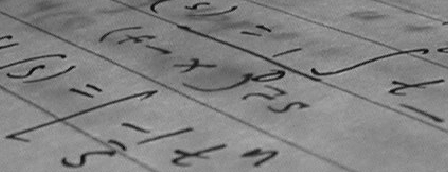

# Obiectiv

Citirea și afișarea imaginilor în tonuri de gri în Matlab, interpretarea
histogramelor, și implementarea binarizării imaginilor prin
metoda Otsu pe baza varianțelor grupurilor.

# Aspecte teoretice

## O imagine în tonuri de gri este o matrice

O imagine digitală este o matrice de pixeli. O imagine în
tonuri de gri stochează câte o valoare a intensității pentru fiecare pixel,
într-o matrice `I`:

- `I(r,c)` este pixelul de pe linia `r`, coloana `c`.
- Valori mici corespund pixelilor întunecați, iar cele mari pixelilor luminoși.
- Pentru o imagine pe 8 biți, stocată ca `uint8`, pixelii sunt numere
  întregi de la 0 (negru) la 255 (alb).
- Dacă imaginea este stocată ca `double`, pixelii sunt numere reale,
  fie în intervalul 0--255, fie în intervalul 0--1.

În acest laborator, preferăm valori ale pixelilor în intervalul 0--1, de tip
`double`, pentru a putea efectua calcule precise.

De exemplu, aceasta este o imagine mică în tonuri de gri:

```matlab
I_small = [0 0.25 0.5 1; 0 0.25 0.5 1; 0 0.25 0.5 1];
figure
imshow(I_small)
```

În exemplul de mai jos:

- `imread()` citește o imagine dintr-un fișier;
- `im2double()` convertește o imagine cu valori întregi la tipul `double`
  și îi rescalează intensitățile în intervalul 0--1;
- `size(I)` întoarce numărul de linii și de coloane (ca pentru orice matrice Matlab);
- `imshow()` afișează imaginea.

```matlab
Iraw = imread('coins.png');
I = im2double(Iraw);
size(I)
figure
imshow(I)
```

Imaginile folosite în acest laborator sunt deja în tonuri de gri, deci nu este
necesară conversia culorilor. O imagine color RGB ar avea trei canale, și poate
fi convertită în tonuri de gri cu `rgb2gray()`.

Pentru imaginile pe 8 biți din acest laborator, `im2double(Iraw)` este echivalent
cu `double(Iraw)/255`. Valoarea 0 reprezintă negrul, iar 1 reprezintă albul.
Conversia folosește întreaga scară de intensități pe 8 biți, nu cea mai mică și
cea mai mare valoare prezente efectiv în imagine; acestea nu devin neapărat 0 și 1.

Conversia nu înseamnă doar schimbarea tipului: `double(Iraw)` păstrează
intensitățile pe 8 biți pe scara 0--255. De asemenea, `im2double()` nu rescalează
un argument care este deja `double`; convertiți direct imaginea originală cu
valori întregi.

De acum înainte, folosiți imaginea normalizată `I` atât pentru afișare, cât și
pentru calcule. `imshow(I)` folosește intervalul 0--1 pentru o imagine `double`;
nu este necesar un argument suplimentar pentru intervalul de afișare. Consultați
[documentația `im2double`](https://www.mathworks.com/help/matlab/ref/im2double.html).

## De la pixeli la histogramă

Histograma imaginii numără câți pixeli au fiecare intensitate și arată
distribuția intensităților.

Folosiți `imhist()` direct pe imagine pentru a afișa histograma intensităților:

```matlab
figure
imhist(I)
xlabel('Intensitate')
ylabel('Număr de pixeli')
```

Pentru o imagine în tonuri de gri, `imhist(I)` folosește implicit 256 de intervale.
Pentru imaginea noastră normalizată, de tip `double`, pozițiile intervalelor
acoperă domeniul 0--1. Folosiți `imhist(I,256)` pentru a specifica explicit acest
număr de intervale la compararea imaginilor. Spre deosebire de o histogramă
normalizată ca densitate de probabilitate, acest grafic arată numărul de pixeli.
Consultați [documentația `imhist`](https://www.mathworks.com/help/images/ref/imhist.html).

Pentru calculul pragurilor, `I(:)` reunește toți pixelii într-un singur vector
coloană, fără a le schimba tipul sau scara intensităților:

```matlab
pixels = I(:);
```

Două zone de concentrare a intensităților pot sugera două grupuri, de exemplu
regiuni întunecate și luminoase. Histograma numără intensitățile, dar nu descrie
pozițiile pixelilor în imagine.

{width=95% fig-align="center"}

Fotografie: Lav Varshney (CC0), prin
[setul de date camera din scikit-image](https://scikit-image.org/docs/stable/api/skimage.data.html#skimage.data.camera).
Figura comparativă: [exemplul de binarizare din scikit-image](https://scikit-image.org/docs/stable/auto_examples/segmentation/plot_thresholding.html).
Această ilustrație externă folosește valori pe 8 biți, pe scara 0--255;
împărțiți aceste intensități și pragul la 255 pentru a le exprima pe scara 0--1
folosită aici. Imaginea binară separă pixelii întunecați de cei luminoși, nu
neapărat întreaga persoană de fundal.

## Observație: egalizarea histogramei

O imagine ale cărei intensități ocupă doar o porțiune îngustă din intervalul
0--1 poate avea un contrast redus. **Egalizarea histogramei** transformă
intensitățile pe baza histogramei cumulative (fracțiunea de pixeli cu
intensitatea mai mică sau egală cu fiecare valoare, ca în cazul FR din
Laboratorul 2). Valorile frecvente sunt distribuite într-un interval mai larg,
fără schimbarea pozițiilor pixelilor. Este o metodă de îmbunătățire a
contrastului, nu de binarizare sau de eliminare a zgomotului, și nu este o
prelucrare preliminară obligatorie pentru metoda Otsu.

```matlab
Ieq = histeq(I,256);
```

Rezultatul are aceeași dimensiune și același tip ca `I`, cu intensități tot în
intervalul 0--1. Comparați `imshow(I)` cu `imshow(Ieq)` și `imhist(I,256)` cu
`imhist(Ieq,256)`. Histograma nu devine neapărat perfect uniformă: pixelii cu
aceeași intensitate inițială primesc în continuare aceeași valoare de ieșire.
Consultați [documentația `histeq`](https://www.mathworks.com/help/images/ref/histeq.html).

{width=90% fig-align="center"}

Pentru a compara grafice în aceeași fereastră, `subplot(2,2,1)` selectează prima
poziție dintr-o grilă de 2 pe 2. Apelați apoi `imshow()` sau `imhist()` pentru a
desena în acea poziție. Pozițiile sunt numerotate de-a lungul primei linii,
apoi de-a lungul celei de-a doua. Folosiți același interval de afișare 0--1
pentru imagini și același număr de intervale pentru histograme, înainte și după.

## Compararea cu un prag și binarizarea imaginilor

**Binarizarea unei imagini** transformă o imagine în tonuri de gri într-o
imagine cu doar două valori (negru și alb). **Compararea cu un prag** este o
modalitate de binarizare: se atribuie o valoare binară intensităților de o
parte a pragului și cealaltă valoare intensităților de cealaltă parte.

Un prag $t$ împarte intensitățile în două grupuri, cele de sub $t$ și cele de
deasupra lui $t$:

$$C_0(t)=\{x:x\le t\}, \qquad C_1(t)=\{x:x>t\}.$$

Aici, fiecare $x$ este intensitatea unui pixel. Comparația produce o **imagine binară**:

```matlab
BW = I > 0.5;
figure
imshow(BW)
```

`BW` are același număr de linii și de coloane ca `I`. Valorile sale sunt `false`
(afișat ca negru) și `true` (afișat ca alb). În această convenție, pixelii albi
sunt cei **deasupra** pragului. Aceasta nu înseamnă automat că pixelii albi
reprezintă obiectele de interes.

Exemple tipice de binarizare:

- **Text tipărit întunecat pe hârtie albă:** separarea cernelii de hârtie.
- **Notițe scrise de mână pe hârtie:** distingerea cernelii întunecate de hârtie,
  chiar și când fotografierea introduce umbre și iluminare neuniformă.
- **Monede luminoase pe un fundal mai întunecat:** separarea monedelor de fundal.

{width=75% fig-align="center"}

Sursă: [imaginea cu text din scikit-image](https://scikit-image.org/docs/stable/api/skimage.data.html#skimage.data.text),
provenită inițial de pe Wikipedia și aflată în domeniul public. Imaginea în
tonuri de gri, nemodificată, este disponibilă local ca `img/Lab5_handwrittenText.png`.

Pentru text sau alte obiecte întunecate, `I > t` păstrează fundalul alb și
obiectele negre. Dacă masca dorită trebuie să marcheze obiectele ca `true`,
folosiți `I <= t`. Alegerea pragului și alegerea grupului care reprezintă
obiectele de interes sunt două decizii separate.

Problema este alegerea unui prag care să separe bine obiectele de interes de
fundal. Metoda Otsu oferă o modalitate de a face acest lucru.

## Criteriul Otsu: grupuri compacte de intensități

Dorim ca pixelii din fiecare grup să aibă intensități similare. Metoda Otsu
alege un prag care minimizează **varianța ponderată din interiorul grupurilor**.

Fie $N$ numărul total de pixeli, iar $N_0(t)$ și $N_1(t)$ numerele de pixeli din
cele două grupuri. Ponderile lor sunt

$$w_0(t)=\frac{N_0(t)}{N}, \qquad w_1(t)=\frac{N_1(t)}{N}.$$

Pentru un grup nevid $C_j(t)$, media și varianța se calculează astfel:

$$m_j(t)=\frac{1}{N_j(t)}\sum_{x\in C_j(t)}x,$$

$$v_j(t)=\frac{1}{N_j(t)}\sum_{x\in C_j(t)}(x-m_j(t))^2.$$

În Matlab, după extragerea intensităților unui grup nevid într-un vector
`cluster`, folosiți `mean()` și `var()` pentru a calcula $m_j(t)$ și $v_j(t)$:

```matlab
mj = mean(cluster);
vj = var(cluster,1);
```

Acestea sunt statistici ale **intensităților pixelilor**, nu ale coordonatelor
pixelilor sau ale măștii binare. Repetați calculele pentru fiecare dintre cele
două grupuri.

Scorul care trebuie minimizat este

$$J(t)=w_0(t)v_0(t)+w_1(t)v_1(t).$$

Ponderile contează: un grup cu puțini pixeli nu trebuie să contribuie la fel de
mult ca unul care conține majoritatea pixelilor. Nu minimizați suma neponderată
a celor două varianțe.

**Normalizarea varianței:** aici descriem toți pixelii observați în fiecare
grup, deci folosim `var(cluster,1)`, cu numitorul egal cu numărul de pixeli din
grup, nu normalizarea implicită a varianței eșantionului din Matlab.
Un grup cu un singur pixel are varianța 0.

### Căutarea tuturor pragurilor

Pentru o imagine obținută prin normalizarea intensităților pe 8 biți, folosiți
256 de praguri candidate pe aceeași scară:

```matlab
thresholds = (0:255)/255;
```

Acestea acoperă intervalul de la 0 la 1, cu pasul `1/255`. La fiecare prag:

1. Extrageți cei doi vectori de pixeli folosind indexarea logică.
2. Dacă unul dintre vectori este vid, nu evaluați acel prag.
3. Altfel, calculați ambele varianțe, ambele ponderi și scorul $J(t)$.
4. Stocați scorul pentru a-l putea reprezenta grafic și a-i identifica minimul.

`isempty(x)` verifică dacă un vector este vid. Într-o buclă `for`, `continue`
sare peste restul iterației curente. Folosiți-le pentru a evita calcularea
varianței unui grup vid.

O posibilitate de stocare a scorurilor este inițializarea unui vector cu infinit:

```matlab
scores = Inf(1,256);
```

Păstrați `Inf` pentru pragurile nevalide, astfel încât acestea să nu poată fi
selectate ca minime. Pentru o imagine neconstantă, cel puțin un prag produce
două grupuri nevide. O imagine constantă nu permite nicio împărțire validă.
Dacă toate scorurile rămân `Inf`, semnalați că nu există un prag valid, în loc
să interpretați indicele returnat de `min()` ca pe un prag valid.

**Indexare:** pragul este acum o intensitate în intervalul 0--1, nu un indice de
vector. Parcurgeți indicii întregi `k=1:numel(thresholds)`, setați
`t=thresholds(k)` și stocați scorul la poziția `k`. Al doilea argument de ieșire
al funcției `min()` oferă un indice:

```matlab
[value, index] = min(v);
```

Folosiți acel indice pentru a găsi intensitatea corespunzătoare în `thresholds`.
Nu folosiți un prag fracționar ca indice al unui tablou Matlab.

Mai multe praguri pot produce aceeași împărțire și același scor dacă există
goluri în histogramă. Folosiți primul prag care minimizează scorul, returnat de
`min()`. Aceasta este o convenție pentru egalități, nu o limită fizică unică.

În acest laborator, implementați singuri căutarea. Nu o înlocuiți cu
`graythresh`, `otsuthresh` sau altă funcție de selectare automată a pragului.

## Rezumat: funcții și notații de cunoscut

<style>
table td, table th { border-bottom: 1px solid #ddd; }
</style>

| Sintaxă sau notație | Exemplu | Descriere |
|---|---|---|
| `imread(filename)` | `Iraw = imread('coins.png')` | Citește o imagine dintr-un fișier |
| `size(I)` | `size(I)` | Dimensiunile imaginii (dimensiunile matricei) |
| `im2double(Iraw)` | `I = im2double(Iraw)` | Convertește o imagine cu valori întregi la intensități `double` normalizate în 0--1 |
| `imshow(I)` | `imshow(I)` | Afișează o imagine `double` normalizată sau o imagine logică |
| `I(r,c)`, `I(:)` | `I(10,20)`, `I(:)` | Accesează un pixel; reunește toți pixelii într-un vector coloană |
| `imhist(I)`, `imhist(I,n)` | `imhist(I,256)` | Afișează histograma imaginii; intensitățile normalizate acoperă intervalul 0--1 |
| `I > t` | `BW = I > 0.5` | Mască logică ce selectează pixelii deasupra unui prag |
| Indexare logică | `pixels(pixels <= t)` | Extrage intensitățile care îndeplinesc o condiție |
| `numel(x)` | `numel(pixels)` | Numărul de elemente |
| `mean(x)` | `mean(cluster)` | Intensitatea medie $m_j(t)$ a unui grup |
| `var(x,1)` | `var(cluster,1)` | Varianța normalizată cu numărul de elemente din grup |
| `isempty(x)`, `continue` | `isempty(cluster)` | Detectează un grup vid; sare peste o iterație a buclei |
| `Inf(m,n)` | `Inf(1,256)` | Inițializează o matrice sau un vector cu infinit |
| `min(x)` | `[value,index] = min(scores)` | Valoarea minimă și indicele primei sale apariții |
| `plot(x,y)` | `plot(thresholds,scores)` | Reprezintă scorul în funcție de pragul candidat |
| `histeq(I,n)` | `histeq(I,256)` | Egalizarea histogramei cu `n` intervale țintă |
| `subplot(m,n,k)` | `subplot(2,2,3)` | Selectează o poziție de afișare într-o grilă |

```{=latex}
\newpage
```

# Exerciții

Scrieți comenzile într-un script sau live script. Etichetați figurile și
răspundeți la întrebările de interpretare în comentarii. Folosiți Matlab cu
Image Processing Toolbox pentru `imhist()` și `histeq()`. Imaginile în tonuri
de gri `coins.png` și `pout.tif` sunt incluse în acest toolbox. Două imagini
didactice suplimentare sunt disponibile în directorul `img/` al laboratorului:
imaginea simulată `Lab5_document.png` și fotografia reală
`Lab5_handwrittenText.png`. Rulați scriptul din `Labs/` pentru ca aceste căi
relative să funcționeze. [Tutorialul de import al imaginilor](https://www.mathworks.com/help/images/image-import-and-export.html)
folosește `pout.tif`, iar [exemplul Otsu din documentație](https://www.mathworks.com/help/images/ref/graythresh.html)
folosește `coins.png`; acesta din urmă este o referință, nu un înlocuitor pentru
bucla pe care trebuie să o scrieți.

Alocare orientativă: 15 minute pentru Exercițiul 1, 10 pentru Exercițiul 2,
65 pentru Exercițiul 3, 10 pentru scurtul experiment din Exercițiul 4 și
20 pentru întrebările finale și verificare.

1. Prima imagine în tonuri de gri:

   a. Citiți `coins.png` în `Iraw`. Convertiți-o cu `im2double()` și stocați
      imaginea normalizată în `I`. Afișați `I` într-o figură.
   b. Determinați dimensiunile imaginii. Câți pixeli conține?
      Comparați cea mai mică și cea mai mare intensitate observată în `Iraw`
      și `I`. Valorile din `I` sunt exact cele din `Iraw` împărțite la 255?
   c. Citiți pixelul de pe linia 50, coloana 100. Creșterea indicelui liniei
      deplasează poziția în jos sau pe orizontală în imaginea afișată?
   d. Reprezentați histograma intensităților direct cu `imhist(I)`.
      Ce intervale de intensități normalizate sunt cele mai frecvente?
   e. Reuniți pixelii într-un vector coloană `pixels`, folosind `I(:)`.
      Folosiți acest vector pentru calcule și păstrați `I` ca matrice pentru afișare.

2. Alegerea vizuală a unui prag:

   a. Anticipați cum se modifică regiunile albe când pragul crește.
   b. Creați și afișați imaginile binare pentru pragurile 0.3, 0.5 și 0.7.
      Folosiți o grilă de afișare cu o linie și trei coloane, indicând pragul
      în titlul fiecărui grafic.
   c. Alegeți unul dintre aceste praguri și explicați alegerea examinând atât
      imaginea, cât și histograma. Sunt toate monedele separate clar de fundal?

3. Implementați metoda Otsu ca funcție:

   a. Creați un fișier nou `otsuManual.m`, în același director cu scriptul,
      cu următorul antet de funcție:

      ```matlab
      function [bestThreshold, minScore, scores, thresholds] = otsuManual(I)
      ```

      Argumentul de intrare `I` este o imagine în tonuri de gri, de tip `double`,
      cu valori în intervalul 0--1. Returnați pragul selectat, scorul său,
      vectorul scorurilor și vectorul pragurilor candidate.
      Încheiați funcția cu `end`.

   b. În interiorul funcției, reuniți pixelii într-un vector, setați
      `thresholds = (0:255)/255` și inițializați scorurile cu `Inf`.
      Scrieți o buclă `for` care împarte pixelii în două grupuri la fiecare
      prag. Dacă un grup este vid, omiteți acel prag; altfel, calculați ambele varianțe
      cu `var(cluster,1)` și scorul lor ponderat $J(t)$.
      După buclă, folosiți primul minim pentru a selecta pragul optim.
      Nu folosiți o funcție Otsu automată.

   c. Apelați funcția din script pentru imaginea cu monede:

      ```matlab
      [bestThreshold, minScore, scores, thresholds] = otsuManual(I);
      ```

      Reprezentați scorurile în funcție de praguri și afișați `bestThreshold`.
      Binarizați `I` folosind acest prag. Afișați rezultatul lângă imaginea
      originală și comparați-l cu alegerea vizuală din Exercițiul 2.

   d. Opțional: apelați aceeași funcție pentru `img/Lab5_handwrittenText.png`
      sau `img/Lab5_document.png`, după citirea și normalizarea imaginii.
      Afișați imaginea, histograma și binarizarea ei. Pentru cerneala întunecată,
      comparați măștile `I > bestThreshold` și `I <= bestThreshold`.

   e. Opțional: testați funcția pe
      `[0.2 0.2 0.2 0.2; 0.8 0.8 0.8 0.8]`. Pot mai multe praguri să producă
      același scor minim și aceeași imagine binară?

4. Scurt experiment suplimentar: egalizarea histogramei (aproximativ 10 minute):

   a. Citiți `pout.tif`, convertiți-o cu `im2double()` și stocați-o în `P`.
      Nu modificați imaginea folosită pentru implementarea metodei Otsu.
   b. Calculați `Peq = histeq(P,256)`. Într-o figură cu 2 pe 2 poziții, afișați
      `P` și `Peq` deasupra histogramelor lor, folosind `imhist(...,256)` pentru
      ambele. Păstrați scara implicită 0--1 pentru afișarea ambelor imagini.
   c. Descrieți pe scurt modificarea contrastului vizibil și a histogramelor.
      Histograma egalizată este perfect uniformă?

# Întrebări finale

1. Rearanjați aleatoriu toți pixelii fără a le schimba intensitățile.
   Se modifică scorul Otsu în funcție de prag? Poate imaginea să arate complet diferit?
2. Să presupunem că minimizați $v_0(t)+v_1(t)$ în locul scorului ponderat.
   De ce s-ar putea schimba pragul ales dacă un grup conține foarte puțini pixeli?
3. Poate un singur prag de intensitate să separe un obiect întunecat de un
   fundal la fel de întunecat? Ce informație lipsește din această regulă de decizie?
4. Poate egalizarea histogramei să recupereze detalii pierdute deoarece mai
   multe intensități diferite din scenă au fost înregistrate ca aceeași valoare a pixelului?
