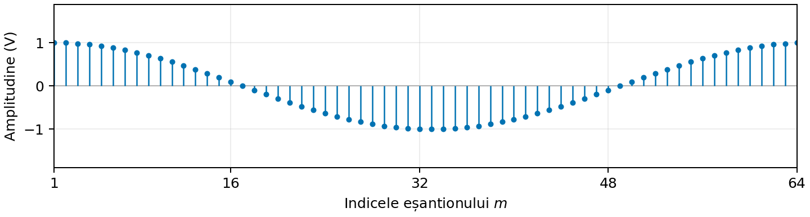
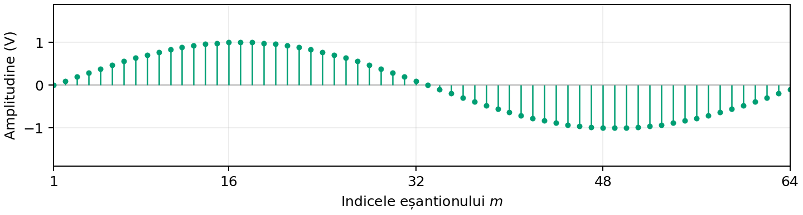
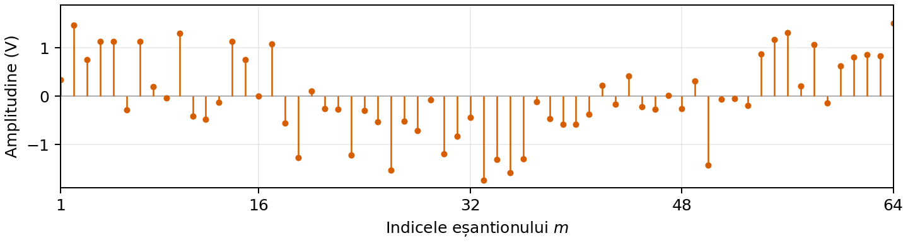

# Obiectiv

Detecția binară folosind mai multe eșantioane, nu doar unul singur.
Implementarea unui receptor bazat pe distanța minimă,
obținerea unui receptor echivalent bazat pe produsul scalar și compararea
deciziilor și a ratelor de eroare în prezența zgomotului.

# Aspecte teoretice

## Eșantioane multiple

În Laboratorul 6, receptorul lua decizia pe baza unui singur eșantion din semnalul recepționat.

Acum, considerăm că receptorul preia **mai multe eșantioane** din forma de undă recepționată.
Prin urmare, lucrăm acum cu **vectori**, nu cu valori individuale:

Receptorul observă un vector $\mathbf{r}$ afectat de zgomot:
$$
\mathbf{r}=\mathbf{s} + \mathbf{n},\qquad b\in\{0,1\},
$$ {#eq-received-waveform}

unde vectorul $\mathbf{s}$ este unul dintre cei doi vectori de referință cunoscuți,
care conțin eșantioanele celor două forme de undă care se pot transmite:

- $H_0$: vectorul $\mathbf{s}_0$ cu eșantioanele lui $s_0(t)$ (bitul 0),
- $H_1$: vectorul $\mathbf{s}_1$ cu eșantioanele lui $s_1(t)$ (bitul 1).

Eșantioanele de zgomot sunt independente și au distribuția
$\mathcal{N}(0,\sigma^2)$, cu aceeași varianță la fiecare poziție de eșantionare
și în ambele ipoteze.

Ca și înainte, receptorul trebuie să ia o **decizie** binară despre
bitul pe care îl consideră recepționat.

De exemplu, fie $s_0(t)$ un cosinus și $s_1(t)$ un sinus, iar
eșantioanele recepționate se află în vectorul $\mathbf{r}$:

$$
\begin{aligned}
\mathbf{s}_0 &= [1.00,\;1.00,\;0.98,\;0.96,\;\ldots,\;0.98,\;1.00],\\
\mathbf{s}_1 &= [0.00,\;0.10,\;0.20,\;0.29,\;\ldots,\;-0.20,\;-0.10],\\
\mathbf{r} &= [0.34,\;1.46,\;0.75,\;1.13,\;\ldots,\;0.83,\;1.51].
\end{aligned}
$$ {#eq-example-sample-vectors}

::: {#fig-waveform-example layout-ncol=1}
{#fig-example-cosine width=95%}

{#fig-example-sine width=95%}

{#fig-example-noisy-cosine width=95%}

Două forme de undă posibile pentru biți și vectorul observațiilor afectate de zgomot.
Fiecare vector conține 64 de eșantioane.
Receptorul trebuie să decidă ce bit a fost transmis, pe baza vectorului recepționat $\mathbf{r}$.
:::

Cum decidem dacă vectorul recepționat $\mathbf{r}$ corespunde bitului 0 sau bitului 1?

Când zgomotul este gaussian, avem două metode echivalente de a lua decizia:

1. **Distanța euclidiană minimă**
2. **Produsul scalar maxim** (filtru adaptat)


## Distanța euclidiană minimă

Calculăm distanța euclidiană de la vectorul $\mathbf{r}$ la fiecare dintre vectorii $\mathbf{s}_0$ și $\mathbf{s}_1$
și alegem distanța cea mai mică.

Distanța euclidiană dintre doi vectori $\mathbf{a}$ și $\mathbf{b}$ este radical din suma diferențelor la pătrat:
$$
d(\mathbf{a},\mathbf{b})=
\sqrt{\sum_{i=1}^{L}(a_i-b_i)^2}.
$$ {#eq-euclidean-distance}

Câștigă distanța cea mai mică:

$$
\newcommand{\grtlessH}{\underset{{H_0}}{\overset{H_{1}}{\gtrless}}}
d(\mathbf{r},\mathbf{s}_0)^2 \grtlessH d(\mathbf{r},\mathbf{s}_1)^2 + 2 \sigma^2 \ln(K) \qquad \qquad
K = \begin{cases}
1, & \text{criteriul ML} \\
\frac{P_0}{P_1}, & \text{criteriul MPE} \\
\frac{(C_{10}-C_{00})P(H_0)}{(C_{01}-C_{11})P(H_1)}, & \text{criteriul MR} \\
\end{cases}
$$ {#eq-squared-distance}

Pentru criteriul **plauzibilității maxime (Maximum Likelihood, ML)**, $K=1$, iar regula de decizie se simplifică la
alegerea distanței celei mai mici:

$$
\newcommand{\grtlessH}{\underset{{H_0}}{\overset{H_{1}}{\gtrless}}}
d(\mathbf{r},\mathbf{s}_0) \grtlessH d(\mathbf{r},\mathbf{s}_1)
$$ {#eq-distance-decision}


## Produsul scalar maxim

Calculăm produsele scalare dintre vectorul recepționat $\mathbf{r}$ și fiecare dintre vectorii de referință $\mathbf{s}_0$ și $\mathbf{s}_1$
și alegem valoarea cea mai mare (cu anumite corecții de energie).

Pentru doi vectori reali $\mathbf{a}$ și $\mathbf{b}$, produsul scalar este:

$$
\langle\mathbf{a},\mathbf{b}\rangle=\sum_{i=1}^{L}a_i b_i.
$$ {#eq-inner-product}

Regula generală de decizie este:

$$
\langle \mathbf{r}, \mathbf{s}_1 \rangle - \frac{E_1}{2}
\underset{H_0}{\overset{H_1}{\gtrless}}
\langle \mathbf{r}, \mathbf{s}_0 \rangle - \frac{E_0}{2}
+ \sigma^2 \ln(K)
$$ {#eq-inner-product-decision-general}

unde

$$
\begin{aligned}
E_0 &= \langle \mathbf{s}_0, \mathbf{s}_0 \rangle,
\qquad
E_1 = \langle \mathbf{s}_1, \mathbf{s}_1 \rangle,
\\[0.5em]
K &=
\begin{cases}
1, & \text{criteriul ML}, \\
\dfrac{P_0}{P_1}, & \text{criteriul MPE}, \\[0.5em]
\dfrac{(C_{10}-C_{00})P_0}{(C_{01}-C_{11})P_1},
& \text{criteriul MR}.
\end{cases}
\end{aligned}
$$ {#eq-inner-product-decision-general-2}

Dacă cele două forme de undă au **energii egale**, $E_0=E_1$, și se folosește criteriul plauzibilității maxime,
regula de decizie se simplifică la:

$$
\langle \mathbf{r}, \mathbf{s}_1 \rangle
\underset{H_0}{\overset{H_1}{\gtrless}}
\langle \mathbf{r}, \mathbf{s}_0 \rangle.
$$ {#eq-inner-product-decision}


## Noțiuni Matlab

### Operații cu vectori

Pentru vectori linie `a` și `b` de aceeași lungime:

```matlab
sum((a - b).^2)  % pătratul distanței euclidiene. Folosiți sqrt() pentru distanța propriu-zisă.
sum(a .* b)      % produsul scalar
sum(a.^2)        % energia discretă a lui a, produsul scalar al lui `a` cu el însuși
```

Folosiți operatorii element cu element `.^` și `.*`.

Asigurați-vă că vectorii `a` și `b` sunt fie ambii vectori linie, fie ambii vectori coloană,
cu aceleași dimensiuni.

## Crearea vectorilor de zerouri și de unități

```matlab
ones(1,L)   % vector linie cu L unități
zeros(1,L)  % vector linie cu L zerouri
```

## Concatenarea obiectelor

```matlab
a = [1 2 3 4 5]
b = [6 7 8 9 10]
[a b]  % concatenarea orizontală a obiectelor a și b
[a; b]  % concatenarea verticală a obiectelor a și b
```

## Rezumat: funcții și notații pe care trebuie să le cunoașteți

<style>
table td, table th { border-bottom: 1px solid #ddd; }
</style>

| Semnătură sau notație | Exemplu | Descriere |
|---|---|---|
| `ones(1,L)`, `zeros(1,L)` | `ones(1,8)` | Vectori linie constanți |
| `[a b]` | `[ones(1,8) zeros(1,8)]` | Concatenarea vectorilor linie |
| `sum((a-b).^2)` | `sum((r-s0).^2)` | Pătratul distanței euclidiene |
| `sum(a.*b)` | `sum(r.*s0)` | Produsul scalar al vectorilor linie reali |
| `sum(a.^2)` | `sum(s0.^2)` | Energia discretă a formei de undă |
| `sigma*randn(1,L)` | `2*randn(1,16)` | Eșantioane independente de zgomot gaussian cu medie zero |
| `rand(1,N) > 0.5` | `bits = rand(1,10000) > 0.5` | Biți aleatori echiprobabili |
| `if ... elseif ... else ... end` | Vezi șabloanele de exemplu | Instrucțiune `if` cu mai multe condiții |
| `for k = 1:N` | `for k = 1:N` | Buclă for. Trebuie încheiată cu `end` |
| `plot(x,y)`, `hold on`, `legend(...)` | `plot(sigmaValues,errorRates)` | Reprezentarea și identificarea observațiilor sau rezultatelor |

```{=latex}
\newpage
```

# Exerciții

1. **Pregătirea datelor**

   a. Creați doi vectori de lungime `L = 16` pentru a reprezenta cele două forme de undă posibile dintr-un interval de bit,
   conform codării Manchester:

      $\mathbf{s}_0 =$ 8 valori de unu, urmate de 8 zerouri

      $\mathbf{s}_1 =$ 8 zerouri, urmate de 8 valori de unu.

      Înmulțiți vectorii cu $A = 5$ pentru a mări amplitudinea.

   b. Reprezentați grafic cei doi vectori.

   c. Calculați energiile $E_0$ și $E_1$ ale celor două forme de undă de referință.

   d. Generați un vector linie recepționat `r`, adăugând zgomot gaussian independent cu media 0 V și deviația standard `sigma = 1.5` V la forma de undă transmisă (alegeți fie `s0`, fie `s1`). Reprezentați grafic vectorul `r`.


2. **Simularea transmisiei**

   Definiți `N = 1000` și `sigma = 1.5`.

   Scrieți o buclă `for` pentru a simula transmisia a `N` biți, câte un bit la fiecare iterație, și numărați cele patru rezultate posibile (rejecție corectă, alarmă falsă, pierdere și detecție corectă).

   a. Înaintea buclei, inițializați contoarele cu zero:
      `countRC`, `countAF`, `countP` și `countDC`,
      precum și `N0` și `N1` (pentru a număra biții transmiși 0, respectiv 1).

   b. Scrieți o buclă for în care `k` variază de la 1 la `N`. La fiecare iterație:

      - Generați un bit aleator `bit`, cu probabilități egale pentru 0 și 1.
        Indiciu: comparați o valoare obținută cu `rand()` cu 0.5.

      - Incrementați `N0` sau `N1`, contorul numărului de biți transmiși 0, respectiv 1.
        Indiciu: folosiți o instrucțiune `if`; nu folosiți `++` (Matlab nu acceptă acest operator).

      - Definiți `s` ca `s0` sau `s1`, în funcție de bitul respectiv. Folosiți o instrucțiune `if`.

      - Generați un vector de zgomot gaussian cu aceleași dimensiuni, cu media 0 și deviația standard `sigma`, și adăugați-l la `s` pentru a obține vectorul recepționat `r`.

      - Calculați pătratele distanțelor de la `r` la `s0` și `s1` și decideți ce bit a fost recepționat.

        ```matlab
        dist0 = ...
        dist1 = ...
        if ...
            decision = 0;
         else
            decision = 1;
         end
         ```

      - Comparați bitul transmis cu bitul decis și incrementați contorul corespunzător situației.
        Indiciu: folosiți `if ... elseif ... else ... end`

        ```matlab
        if ...
             ...
        elseif ...
             ...
        elseif ...
             ...
        else
             ...
        end
        ```

   d. Estimați cele patru probabilități condiționate, împărțind numărul de cazuri la numărul de biți transmiși de fiecare tip.

   e. Calculați numărul total de erori și probabilitatea totală de eroare.

3. **Adăugarea regulii de decizie bazate pe produsul scalar**

   Adăugați regula de decizie bazată pe produsul scalar în simulare și notați rezultatul cu `decision2`.

   Verificați că `decision2` este întotdeauna egal cu `decision`.
      Indiciu: folosiți funcția `assert()` și verificați egalitatea.


4. **Efectul zgomotului, amplitudinii și semnalelor**

   a. Încercați valori diferite ale amplitudinii $A$ (de exemplu, 1, 2, 5, 10). Cum se modifică probabilitatea de eroare? Explicați de ce.

   b. Păstrați $A = 5$ și încercați valori diferite ale deviației standard a zgomotului $\sigma$ (de exemplu, 0.5, 1, 1.5, 2, 3). Cum se modifică probabilitatea de eroare? Explicați de ce.

   c. Păstrați $A = 5$ și $\sigma = 1.5$, dar încercați alte forme de undă. Cum se modifică probabilitatea de eroare?

      - forme de undă mai lungi (de exemplu, 32 de eșantioane în loc de 16), folosind aceeași schemă de codare (unități și zerouri)
      - un cosinus și un sinus, cu aceeași amplitudine și același număr de eșantioane

# Întrebări finale

TBD
