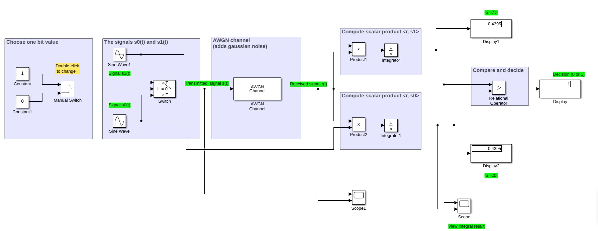
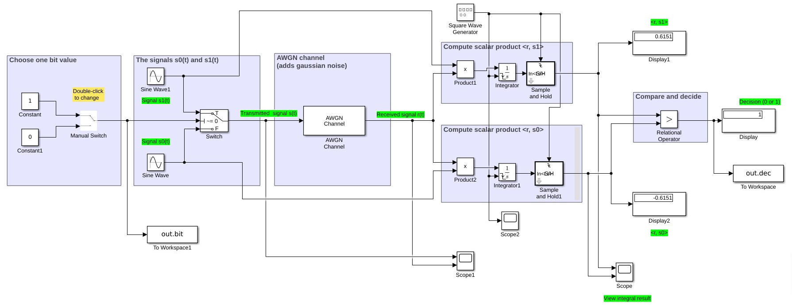
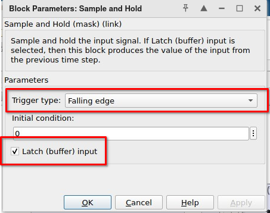
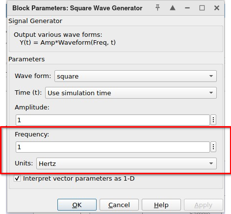
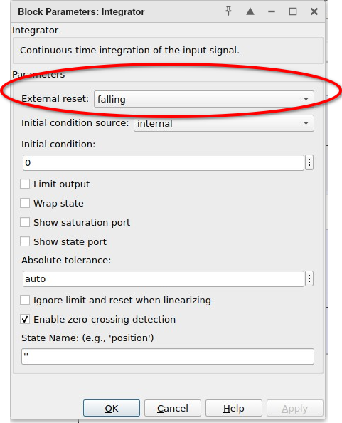
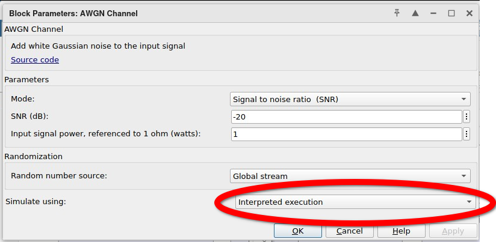
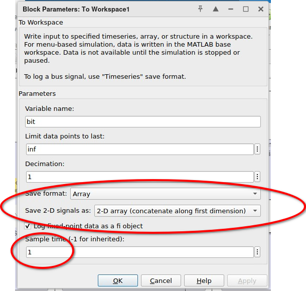

# Obiectiv

Implementarea unui model de transmisie și detecție BPSK în Simulink.

Modelul folosește mediul Simulink, împreună cu
Communications Toolbox (AWGN Channel) și
DSP System Toolbox (Sample and Hold).

# Aspecte teoretice

## Modulația BPSK

Modulația digitală **BPSK** (Binary Phase Shift Keying) folosește un cosinus cu faza $0$
pentru a reprezenta bitul 1 și un cosinus cu faza $\pi$ pentru a reprezenta bitul 0.
Formele de undă transmise sunt, așadar:

$$
s_1(t)=\cos(2\pi f t),\qquad s_0(t)=-\cos(2\pi f t).
$$

Cele două forme de undă au aceeași energie, deoarece au doar semnul contrar.

La receptor, criteriul plauzibilității maxime (Maximum Likelihood, ML) poate fi folosit pentru a decide ce bit a fost transmis.

Presupunând că zgomotul este gaussian, regula de decizie ML se bazează pe produsele
scalare ale semnalului recepționate cu cele două semnale de referință:

$$
\langle \mathbf{r}, \mathbf{s}_1 \rangle
\underset{H_0}{\overset{H_1}{\gtrless}}
\langle \mathbf{r}, \mathbf{s}_0 \rangle.
$$ {#eq-inner-product-decision}

Decizia este câștigată de către produsul scalar mai mare.

Cele două produse scalare pot fi calculate înmulțind forma de undă recepționată cu
fiecare referință și integrând pe durata unui bit.

## Lucrul în Simulink

Vom implementa și simula un model de transmisie și detecție BPSK în Simulink.

### Blocurile folosite în modele

| Bloc | Rol și setări |
|---|---|
| Constant | Valorile `1` și `0`: cei doi biți care pot fi transmiși |
| Manual Switch | Selectează blocul Constant care furnizează bitul |
| Sine Wave, pentru $s_1$ | Time based; amplitudine `1`; bias `0`; frecvență `2*pi` rad/s; fază `0`; sample time `0` |
| Sine Wave, pentru $s_0$ | Aceleași setări, dar amplitudine `-1` |
| Switch | Trei intrări: $s_1$ sus, bitul de control la mijloc, $s_0$ jos; criteriul `u2 ~= 0` |
| AWGN Channel | Adaugă zgomot gaussian; modul `Signal to noise ratio (SNR)` |
| Product | Două intrări, înmulțire element cu element: semnalul recepționat cu un semnal referință |
| Integrator | Condiție inițială `0`; integrează ieșirea fiecărui bloc Product |
| Relational Operator | Operatorul `>`; compară două valori |
| Scope, Display | Afișează forme de undă și valori |
| Square Wave Generator | Doar în Modelul 2: generează impulsuri dreptunghiulare |
| Sample and Hold | Doar în Modelul 2: eșantionează și reține o valoare pentru fiecare bit |
| To Workspace | Doar în Modelul 2: exportă bitul și decizia ca vectori |

### Explicații generale

Pentru simulare, considerăm că fiecare bit durează o secundă de timp de simulare.
Din acest motiv, setăm frecvența blocurilor Sine Wave la $f=1$ (adică $\omega = 2\pi$ rad/s),
astfel încât o perioadă a cosinusului să dureze o secundă.
În practică, frecvența este mult mai mare, iar un bit conține multe perioade ale cosinusului purtător.

```{=latex}
\newpage
```

# Exerciții

1. **Transmiterea și detectarea unui bit.**

   Implementați modelul din @fig-lab8-model1 și salvați-l ca `Lab8_OneBit.slx`.

   {#fig-lab8-model1 width=100%}

   a. Selectați bitul 1 cu Manual Switch. Rulați modelul timp de 1 secundă (setați Stop Time la `1`).

      Identificați și observați următoarele:

      - formele de undă transmise și recepționate (afectate de zgomot)
      - rezultatul blocurilor Integrator
      - valorile celor două produse scalare la sfârșitul rulării
      - valoarea deciziei finale

   b. Rulați de mai multe ori și observați cum zgomotul modifică forma de undă recepționată și valorile produselor scalare.

   c. Setați SNR la `-20` dB. Rulați modelul de 10 ori pentru fiecare valoare a bitului și observați deciziile.

      Câte alarme false și pierderi observați?

   d. Setați SNR la `-40` dB și repetați. Alarmele false și pierderile sunt acum mai frecvente?

2. **Implementați modelul pentru transmiterea mai multor biți.**

   Implementați modelul din @fig-lab8-model2 și salvați-l ca `Lab8_RepeatedBits.slx`.

   Porniți de la o copie a modelului anterior și efectuați modificările explicate mai jos.

   {#fig-lab8-model2 width=100%}

   În acest model, vom transmite și recepționa mai mult de un bit.
   Pentru aceasta, trebuie să eșantionăm valorile integratoarelor după fiecare bit și să le reținem până la recepția bitului următor.
   De asemenea, trebuie să resetăm integratoarele la sfârșitul fiecărui bit, astfel încât să pornească de la zero pentru bitul următor.
   În plus, salvăm datele în Workspace, pentru analiza ulterioară.

   Modificările necesare pentru a implementa Modelul 2 pornind de la Modelul 1:

   1. Adăugați blocuri **Sample and Hold** după fiecare integrator.

      Setați **Trigger type** ca `Falling edge` și bifați `Latch (buffer) input`,
      ca în @fig-lab8-sample-settings.

   2. **Resetați integratoarele în fiecare secundă.** Pentru aceasta, setați **External reset** la **falling** pentru ambele blocuri Integrator.

   3. Adăugați un bloc **Square Wave Generator** și configurați-l ca în @fig-lab8-square-settings.

      Conectați-l la External Reset al ambelor integratoare și la Trigger al ambelor blocuri Sample and Hold.

      Acum, frontul descrescător al semnalului dreptunghiular va declanșa blocurile Sample and Hold pentru a prelua valorile integratoarelor, iar integratoarele se vor reseta la zero pentru bitul următor.

   4. Adăugați blocuri **To Workspace** pentru a trimite valorile biților în Workspace.

      Configurați blocurile ca în @fig-lab8-workspace-settings.

   5. Pentru blocul AWGN, setați **Simulate using: Interpreted execution**, ca în @fig-lab8-awgn-settings.

   6. Setați **Stop Time** la `1000` de secunde și **SNR** la `-20` dB.

   ::: {#fig-lab8-model2-settings layout-ncol=2}

   {#fig-lab8-sample-settings width=100%}

   {#fig-lab8-square-settings width=100%}

   {#fig-lab8-integrator-settings width=100%}

   {#fig-lab8-awgn-settings width=100%}

   {#fig-lab8-workspace-settings width=100%}

   Setările blocurilor pentru Modelul 2.
   :::

3. **Transmiteți 1000 de biți de 1, apoi 1000 de biți de 0.**

   a. Setați din nou SNR la `-20` dB și Stop Time la `1000`. Selectați bitul 1 și
      rulați modelul.

      Vectorii de intrare și ieșire sunt salvați în `out.bit` și `out.dec`. În Matlab, putem calcula probabilitățile de detecție corectă și pierdere astfel:

      ```matlab
      b = out.bit(2:end);     % Omitem prima valoare, cea de la inițializare
      d = out.dec(2:end);     % Omitem prima valoare, cea de la inițializare

      p_cd = sum(d==1)/sum(b);  % Probabilitatea de detecție corectă
      p_miss = sum(d==0)/sum(b); % Probabilitatea de pierdere
      ```

   b. Selectați bitul 0 și rulați modelul pentru încă 1000 de secunde.

      Calculați probabilitățile de alarmă falsă și rejecție corectă, folosind o abordare similară.

   c. Schimbați SNR la `-10` dB și repetați cele două rulări de câte 1000 de biți. Comparați rezultatele cu cele anterioare.
