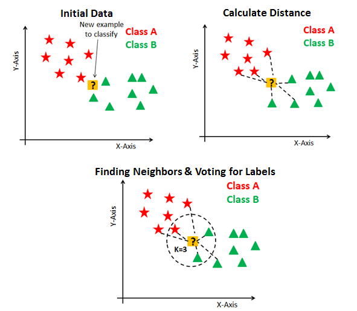

# Obiectiv

Implementarea și utilizarea algoritmului k-NN pentru clasificarea semnalelor ECG.
Evaluarea clasificării cu ajutorul unei matrice de confuzie și studierea efectelor
zgomotului și ale unei componente continue.

Funcțiile k-NN încorporate folosite aici necesită Statistics and Machine Learning Toolbox.

# Aspecte teoretice

## Decizia ML cu mai multe eșantioane în zgomot gaussian

Într-o problemă de detecție cu zgomot gaussian aditiv, staționar, și cu media zero,
criteriul plauzibilității maxime (Maximum Likelihood, ML)
se reduce la **alegerea celei mai mici distanțe**.

$$
\providecommand{\grtlessH}{\underset{{H_0}}{\overset{H_{1}}{\gtrless}}}
d(\mathbf{r}, \mathbf{s}_0) \grtlessH d(\mathbf{r}, \mathbf{s}_1)
$$

În cazul mai multor eșantioane, presupunând că eșantioanele de zgomot sunt independente,
distanța folosită este distanța euclidiană:

1. Avem vectori de eșantioane: $\mathbf{r}, \mathbf{s}_0, \mathbf{s}_1$ (variabilele cu bold indică un vector)
2. Distanța dintre oricare doi vectori $\mathbf{a}$ și $\mathbf{b}$ este **distanța euclidiană**:
   $$
   d(\mathbf{a}, \mathbf{b}) = \sqrt{(a_1 - b_1)^2 + (a_2 - b_2)^2 + \cdots + (a_n - b_n)^2}
   $$
3. Folosim aceeași regulă bazată pe distanță, cu distanța euclidiană.

   Câștigă cea mai mică distanță.

## Algoritmul k-NN

Presupunem că avem un set de **semnale de antrenare** ale căror clase sunt cunoscute dinainte.
De exemplu:

- 100 de semnale din clasa A (de exemplu, bătăi normale ale inimii)
- 100 de semnale din clasa B (de exemplu, bătăi ale inimii cu un anumit tip de aritmie)
- eventual, mai multe clase

Avem un semnal nou $\mathbf{x}$. Trebuie să decidem cărei clase îi aparține (clasei A, clasei B etc.).

Putem folosi **algoritmul k-NN**:

1. Calculăm distanțele de la $\mathbf{x}$ la toate semnalele din setul de antrenare
2. Alegem **cei mai apropiați $k$ vecini** și luăm **clasa majoritară** dintre acești vecini
   (vot majoritar). Decidem că aceasta este clasa lui $\mathbf{x}$.

Același principiu se aplică atunci când avem mai mult de două clase
(alegem clasa majoritară).
În caz de egalitate, putem fie să alegem aleatoriu, fie să găsim o regulă de departajare.

Mai jos este o ilustrare vizuală[^1]:



[^1]: Imagine din ["KNN Classification using Scikit-learn", Avinash Navlani](https://www.datacamp.com/community/tutorials/k-nearest-neighbor-classification-scikit-learn)

## Organizarea seturilor de date

De obicei, avem un set mare de semnale ale căror clase sunt cunoscute. Datele sunt
împărțite aleatoriu în:

- un **set de antrenare**: folosit pentru a găsi vecinii și voturile lor;
- un **set de validare** (opțional): folosit pentru a alege parametri precum $k$;
- un **set de testare**: folosit doar pentru evaluarea clasificatorului final pe semnale nevăzute anterior.

De exemplu, o împărțire ar putea folosi $70\%$ din setul de date pentru antrenare, $15\%$ pentru validare și
$15\%$ pentru testare. Validarea încrucișată este o altă metodă de alegere a lui $k$, folosind
împărțiri repetate în date de antrenare și de validare în interiorul setului de antrenare.

Datele furnizate în acest laborator sunt deja împărțite în seturi de antrenare și de testare. În acest laborator,
comparăm experimental mai multe valori prestabilite ale lui $k$ pe setul de testare;
alegerea lui $k$ pe baza acestor rezultate ar necesita un alt set de testare, nevăzut anterior,
pentru o evaluare finală nepărtinitoare.

## Algoritmul k-NN în Matlab

Matlab oferă mai multe implementări ale algoritmului k-NN.

Pentru scopurile noastre putem folosi funcția `knnsearch()`.

Apelul de mai jos găsește cei mai apropiați 10 vecini din X pentru fiecare vector din Y
și returnează indicii liniilor acestora în `Idx` și distanțele euclidiene în `D`.
`X` și `Y` conțin vectorii pe **linii**. Fiecare linie din `Idx` și `D` corespunde
unui vector de interogare din `Y`; cei 10 vecini sunt ordonați crescător după distanță.

```matlab
% găsește cei mai apropiați 10 vecini pentru vectorii din Y
[Idx, D] = knnsearch(X, Y, 'K', 10);
```

Se poate folosi și funcția `fitcknn()`, dedicată clasificării.
`fitcknn()` creează un obiect de tip **model de clasificare**.
Apelarea ulterioară a funcției `predict()`, cu acest model ca argument,
va rula algoritmul de clasificare și returnează clasa prezisă,
pentru vectori de testare dați.

```matlab
Mdl = fitcknn(X,Y, 'NumNeighbors', 3);    % folosește 3 vecini
label = predict(Mdl, test_data);
```
- `X` = datele de antrenare, fiecare linie fiind un vector
- `Y` = clasele datelor de antrenare, fiecare valoare reprezentând clasa vectorului corespunzător
- `test_data` = datele de testare, fiecare linie fiind un vector pentru care prezicem clasa

## Matricea de confuzie

O **matrice de confuzie** $A$ este folosită pentru a verifica performanța unui model de clasificare,
comparând etichetele prezise cu etichetele reale:

$$
A_{ij}=\text{numărul semnalelor de testare din clasa reală }c_i
\text{ prezise ca aparținând clasei }c_j.
$$

Liniile reprezintă **clasele reale**, iar coloanele reprezintă **clasele prezise**.
Pentru etichetele `0`, `1`, `2`, `3`, folosiți o ordine fixă:

```matlab
A = confusionmat(true_labels, predicted_labels, 'Order', [0 1 2 3]);
```

Diagonala conține clasificările corecte.
**Acuratețea globală a clasificării** este suma elementelor de pe diagonală împărțită la numărul total de semnale de testare,
adică fracțiunea semnalelor de testare care au fost clasificate corect.

## Datele pentru acest laborator

În acest laborator folosim semnale ECG din
[baza de date MIT-BIH Arrhythmia](https://physionet.org/content/mitdb/1.0.0/).

![Exemplu de semnal ECG din baza de date MIT-BIH Arrhythmia [^2]](img/MITBIH.png)

[^2]: Imagine de pe [pagina bazei de date PhysioNet](https://archive.physionet.org/physiobank/database/mitdb/).

Extrasul conține **4 clase**, cu **120 de semnale pe clasă**: o clasă de
bătăi normale ale inimii și trei clase de bătăi aritmice (anormale).
Acestea sunt clase de bătăi ale inimii, nu diagnostice de persoane sănătoase sau bolnave.

Semnalele au fost segmentate în bătăi individuale ale inimii, redimensionate la
**256 de eșantioane** și aliniate în jurul vârfului R.

Datele sunt deja împărțite în două seturi:

| Fișier | Semnale | Etichete | Organizare |
|---|---|---|---|
| `ECG_train.mat` | `train`, $256 \times 400$ | `train_labels`, $1 \times 400$ | 100 de semnale pe clasă |
| `ECG_test.mat` | `test`, $256 \times 80$ | `test_labels`, $1 \times 80$ | 20 de semnale pe clasă |

Etichetele claselor sunt `0`, `1`, `2` și `3`. În ambele matrice, **fiecare coloană este un semnal**.
Elementul corespunzător din vectorul de etichete indică clasa acestuia.

Setul de antrenare este folosit pentru a găsi cei mai apropiați vecini și voturile lor
în timpul rulării algoritmului.
Setul de testare și etichetele de testare sunt folosite doar pentru evaluarea clasificatorului.
Setul de testare și etichetele sale nu trebuie folosite niciodată în alte scopuri decât evaluarea.

Pentru a folosi `fitcknn()` sau `knnsearch()`, transpuneți matricele de semnale cu `.'`,
astfel încât fiecare semnal să devină o **linie**, deoarece funcțiile așteaptă semnalele de intrare pe linii.
Pentru `fitcknn()`, transformați și etichetele de antrenare într-o coloană cu `train_labels(:)`.

## Rezumat: funcții și notații pe care trebuie să le cunoașteți

| Funcție sau notație | Semnificație |
|---|---|
| `load('ECG_train.mat')` | Încarcă `train` și `train_labels` în Workspace; variabilele existente cu aceste nume sunt suprascrise |
| `train(:,j)`, `train_labels(j)` | Semnalul din coloana `j` și clasa sa |
| `find(train_labels == c)` | Indicii semnalelor de antrenare din clasa `c` |
| `X.'`, `labels(:)` | Transpunerea unei matrice; reorganizarea etichetelor într-o coloană |
| `sqrt(sum((a-b).^2))` | Distanța euclidiană dintre doi vectori |
| `[d, idx] = sort(distances)` | Ordonează distanțele crescător și returnează indicii lor inițiali |
| `[Idx,D] = knnsearch(X,Y,'K',k)` | Găsește cele mai apropiate linii de antrenare din `X` pentru fiecare linie de interogare din `Y` |
| `fitcknn(X,labels,'NumNeighbors',k)` | Creează un model k-NN; distanța implicită este cea euclidiană |
| `predict(Mdl,Y)` | Prezice o etichetă pentru fiecare linie de interogare din `Y` |
| `confusionmat(truth,prediction,'Order',[0 1 2 3])` | Numără clasificările cu o ordine fixă a claselor |
| `sigma*randn(size(test))` | Zgomot gaussian independent, de medie zero și deviație standard `sigma`, de aceeași dimensiune ca `test` |
| `test + b` | Adaugă aceeași componentă continuă `b` la fiecare eșantion |

# Exerciții

1. **Explorați setul de date.** Încărcați `ECG_train.mat` și `ECG_test.mat`.

   a. Verificați numele și dimensiunile variabilelor. Afișați 3 semnale de antrenare din
      fiecare clasă. Ce diferențe vizuale puteți identifica?

   b. Afișați primul semnal din setul de testare. Încercați să determinați vizual
      cărei clase îi aparține, fără a consulta eticheta sa de testare.

2. **Clasificați manual un semnal.** Luați primul semnal de testare și clasificați-l folosind k-NN
   cu $k=5$.

   Puteți folosi `knnsearch()` pentru a găsi cei mai apropiați vecini,

   sau puteți face calculele manual, urmând pașii de mai jos:

   - Calculați distanța euclidiană de la acesta la fiecare dintre cele 400 de semnale de antrenare.
     Stocați distanțele într-un vector de lungime 400.

   - Găsiți cele mai mici 5 distanțe și etichetele semnalelor de antrenare
     corespunzătoare.

   - Determinați clasa prezisă (în cuvinte, nu în cod).
     Comparați-o cu eticheta reală `test_labels(1)`.

3. **Folosiți clasificatorul încorporat.**

   Folosiți `fitcknn()` și `predict()` cu $k=5$ pentru a prezice clasa aceluiași
   semnal de testare. Rețineți că aceste funcții așteaptă un semnal pe fiecare **linie**.

   Comparați rezultatul cu cel din Exercițiul 2. Ar trebui să fie același. Dacă nu, verificați calculele.

4. **Calculați matricea de confuzie.**

   a. Folosiți `fitcknn()` și `predict()` pentru a clasifica toate cele 80 de semnale de testare. Repetați
      pentru $k=1$, $k=5$ și $k=15$. Păstrați setul de antrenare neschimbat.

   b. Comparați fiecare vector de predicții cu `test_labels(:)` și calculați o
      matrice de confuzie $4 \times 4$ pentru fiecare valoare a lui $k$.
      Verificați că fiecare linie din matricea de confuzie are suma 20 și că toate elementele au suma 80.

   c. Calculați acuratețea globală pentru fiecare valoare a lui $k$. Care clase sunt
      confundate cel mai des?

5. **Adăugați zgomot gaussian.** Repetați Exercițiul 4 după adăugarea unui zgomot gaussian independent,
   de medie zero, la semnalele de testare.

   Scopul este să observați cum scade performanța clasificării în prezența zgomotului.

   a. Încercați deviațiile standard $\sigma=0.02$, $0.05$ și $0.1$.

      Pentru fiecare nivel de zgomot, generați zgomot și adăugați-l la semnalele de testare originale.
      Apoi clasificați semnalele de testare zgomotoase cu $k=1$, $k=5$ și $k=15$.

   b. Comparați matricele de confuzie și acuratețile cu referința fără zgomot.
      Cum se schimbă performanța? Păstrați setul de antrenare original neschimbat.

6. **Adăugați o componentă continuă.** Repetați Exercițiul 4 cu o valoare constantă adăugată la toate
   eșantioanele de testare. Încercați $b=0.02$, $0.05$ și $0.1$.

   a. Porniți de fiecare dată de la semnalele de testare originale, **fără zgomot adăugat**,
      și adăugați valoarea constantă $b$ la semnalele de testare.
      Apoi clasificați semnalele de testare cu această componentă continuă cu $k=1$, $k=5$ și $k=15$.

   b. Comparați matricele de confuzie și acuratețile cu referința inițială.
      Cum afectează o componentă continuă distanțele euclidiene și clasificarea?

# Întrebări finale

1. Cum arată matricea de confuzie pentru o clasificare perfectă?
   Care sunt elementele sale de pe diagonală pentru acest set de testare?

2. Clasele dezechilibrate (numere diferite de semnale de antrenare pe clasă)
   pot crea o problemă pentru votul k-NN? Ar fi suficientă doar acuratețea globală pentru
   a evalua un clasificator pe un set de testare dezechilibrat?
